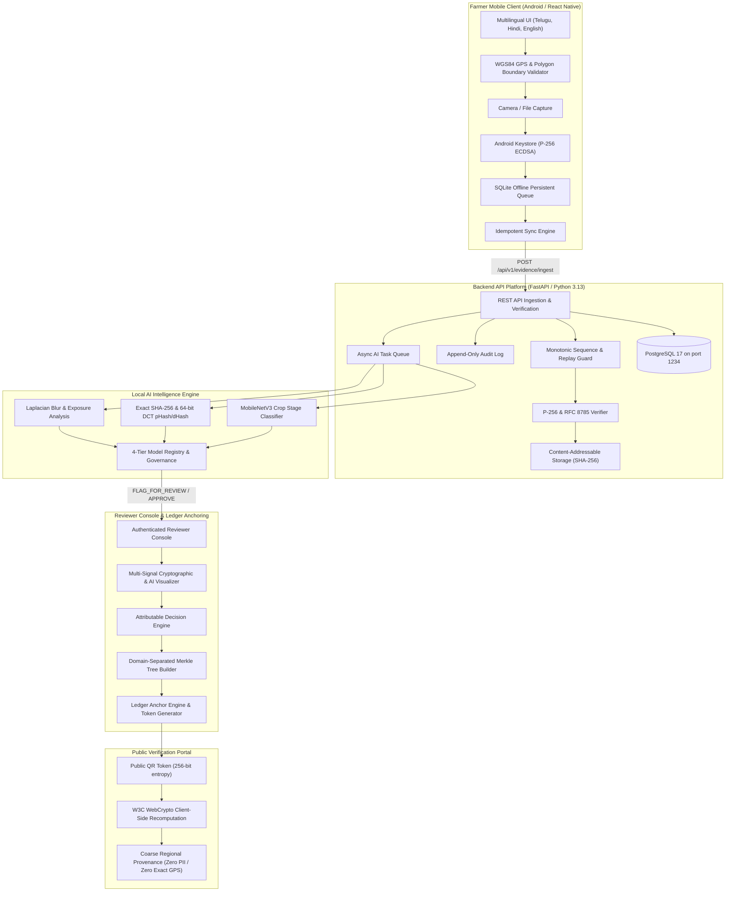
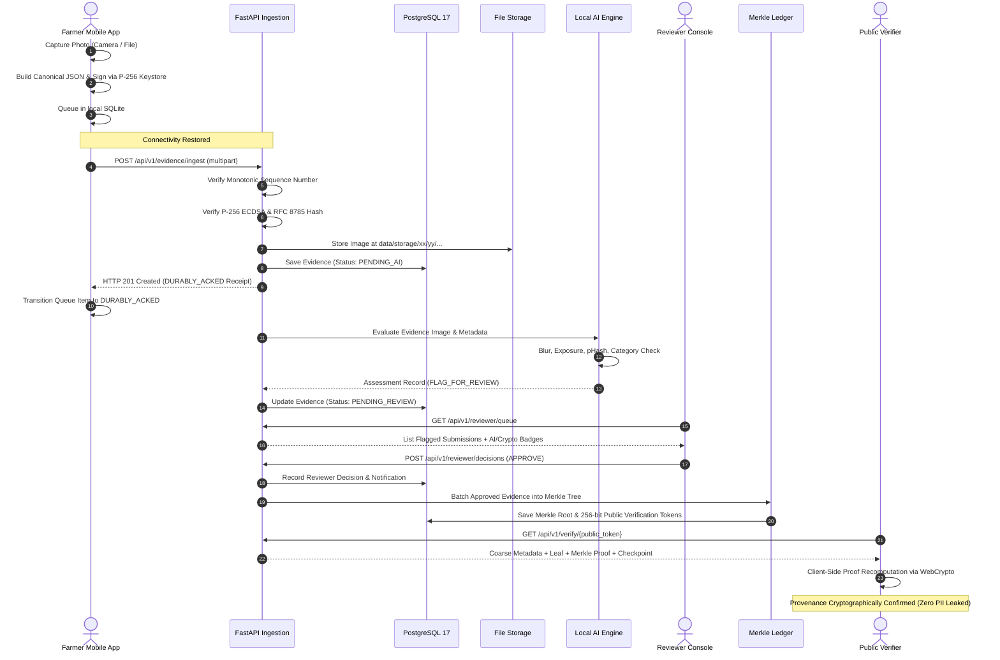

# PRAMAN System Architecture

## 1. Executive Summary

PRAMAN is an offline-first evidence intelligence and trusted provenance platform designed for agricultural assurance, proof of cultivation, and supply-chain integrity. It enables smallholder farmers to capture tamper-evident photographic evidence under intermittent connectivity, verifies evidence authenticity using on-device cryptographic signing and local artificial intelligence, anchors verified records into cryptographic Merkle trees, and provides privacy-preserving public verification without compromising farmer personal information or exact geographic coordinates.

---

## 2. Core Architectural Principles

1. **Deterministic Cryptographic Grounding**: Every piece of evidence is bound to an RFC 8785 canonical JSON envelope, hashed via SHA-256, and signed on-device with NIST P-256 ECDSA.
2. **Offline-First Resilience**: Field operations in remote rural areas cannot assume cellular network availability. All capture artifacts, metadata, and signatures are queued locally in SQLite and synchronized idempotently upon network restoration.
3. **Monsoon/Disaster Legitimacy**: Extended offline delays (14 to 60+ days) due to monsoon floods, infrastructure failure, or agricultural isolation are treated as legitimate and never marked as fraudulent based solely on network latency.
4. **Local CPU AI Execution**: AI inference runs 100% locally on standard CPU hardware using PyTorch, OpenCV, and Pillow. No cloud APIs, proprietary paid endpoints, or telemetry leaks exist.
5. **Human-in-the-Loop Safeguards (Never-Autonomous-Reject)**: The AI engine acts strictly as an advisory triage filter. Inconclusive or low-quality submissions are flagged to `PENDING_REVIEW` for human agronomic evaluators; the AI never autonomously rejects evidence.
6. **Domain-Separated Merkle Ledgering**: Batch records use standard domain separation (`0x00` leaf prefix, `0x01` internal node prefix) with odd-node promotion to resist second-preimage and CVE-2012-2459 duplication attacks.
7. **Privacy-Preserving Public Verification**: Consumers and third-party auditors verify cryptographic proofs and checkpoint validity on the public portal without exposing farmer phone numbers, names, or fine-grained GPS coordinates.

---

## 3. Component Breakdown

### 3.1 Shared Cryptography (`crypto/`)
- **RFC 8785 Canonicalization (`rfc8785.py`)**: Deterministic key sorting (UTF-16 code units), strict float formatting matching ECMAScript specifications, and unescaped safe characters.
- **ECDSA P-256 Engine (`ecdsa_p256.py`)**: Key generation, ASN.1 DER and IEEE P1363 signature serialization, and strict low-$s$ normalization ($s \le \lfloor n/2 \rfloor$) rejecting signature malleability.
- **Evidence Envelope (`envelope.py`)**: Binds device ID, farm ID, evidence ID, image SHA-256, capture source, GPS metadata, sequence number, and schema version.
- **Merkle Tree & Proof Engine (`merkle.py`)**:
  - Leaf hash: $H_{\text{leaf}} = \text{SHA-256}(0\text{x}00 \parallel \text{data})$
  - Node hash: $H_{\text{node}} = \text{SHA-256}(0\text{x}01 \parallel L \parallel R)$
  - Odd-node promotion: Unpaired rightmost nodes at odd levels are promoted directly to the next level without duplication.
  - Audit paths: Left/right directional inclusion proofs verified against trusted checkpoint roots.

### 3.2 Backend API Platform (`backend/`)
- **Framework**: FastAPI on Python 3.13.9.
- **Database**: PostgreSQL 17 running on localhost port 1234, accessed via SQLAlchemy 2.0 and Alembic.
- **Storage**: Sharded content-addressable filesystem (`data/storage/ab/cd/abcdef...`).
- **Sequence Enforcer**: Validates monotonic counter per device ($S = S_{\text{last}} + 1$). Returns `HTTP 409 Conflict` on replay or gaps, and `HTTP 200 OK` on idempotent retries of identical submissions.
- **Audit Logger**: Append-only log table recording timestamps, actors, actions, and previous/new states.

### 3.3 Local AI Intelligence Engine (`ai_engine/`)
- **Quality Assessor (`quality.py`)**:
  - Blur detection via Laplacian variance ($\sigma^2 < 100.0$ indicates blur).
  - Exposure analysis via luminance histogram clipping (under-exposure $<15$ and over-exposure $>240$).
  - Resolution and aspect ratio validation (minimum $640 \times 480$, aspect ratio between $0.5$ and $2.0$).
  - EXIF consistency checks.
- **Deduplication & Perceptual Hashing (`hashing.py`)**:
  - Exact match via SHA-256.
  - 64-bit DCT perceptual hashing (pHash) and difference gradient hashing (dHash).
  - Hamming distance comparison (distance $\le 10$ flags potential replay).
- **Crop Category Classifier (`classifier.py`)**: Offline MobileNetV3-small backbone classifying agricultural scene context against declared lifecycle stages (`SOWING`, `INPUT_APPLICATION`, `CROP_GROWTH`, `HARVEST`, `STORAGE`).
- **Model Registry & Governance (`registry.py`, `unvalidated.py`)**: Catalog of 4 model tiers (`deterministic`, `pretrained`, `custom`, `heuristic`). Experimental manipulation detectors are explicitly governed and marked unvalidated.

### 3.4 Farmer Mobile Application (`mobile/`)
- **Platform**: React Native TypeScript for Android.
- **Multilingual Support**: Telugu (`te`), Hindi (`hi`), English (`en`) with complete translation key parity.
- **Spatial Validation**: WGS84 GPS coordinate capture and farm boundary polygon validation (minimum 3 vertices, closure verification, non-self-intersection).
- **Keystore Signing Bridge**: Android Keystore P-256 key generation with low-$s$ normalized signing of canonical envelopes.
- **Offline Sync State Machine**: State transitions (`QUEUED` $\to$ `SYNCING` $\to$ `DURABLY_ACKED` / `FAILED`) ensuring data durability.

### 3.5 Reviewer Console & Public Verification (`web_console/`)
- **Reviewer Dashboard**: Authenticated queue for reviewing flagged evidence with original high-resolution photos, cryptographic signature badges, and AI diagnostic signals.
- **Attributable Decisions**: Enforces review decisions (`APPROVED`, `REJECTED`, `RETAKE_REQUESTED`) with mandatory notes, which dispatch farmer notifications.
- **Batch Anchoring Engine**: Commits approved evidence into Merkle trees, generating 256-bit unguessable public tokens.
- **Public Portal**: Client-side proof recomputation using W3C WebCrypto API against signed authority checkpoints, displaying coarse location (district/state) with zero farmer PII.

---

## 4. End-to-End Data Flow

